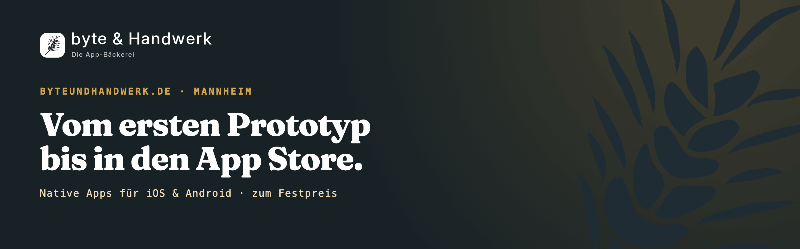

  

## byte & Handwerk – die App-Bäckerei

Native Apps, Web-Apps und Backends vom Prototyp bis zur Veröffentlichung. Sechs Pakete mit Festpreis, von einem gelernten Bäcker in Mannheim.

Hinter byte & Handwerk stehe ich, [Dominik Baki](https://github.com/Code-Noob82): gelernter Bäcker, heute App-Entwickler. Ich entwickle native Apps für iOS und Android, vom ersten Prototyp bis in den App Store.

## Sechs Pakete mit Festpreis

| Paket | Was drin ist | Dauer |
| --- | --- | --- |
| [Brötchen (Quick-Fix)](https://byteundhandwerk.de/quick-fix) | Ein Fehler, ein Update, ein prüfender Blick in den Code. Schnell gebacken, sofort mitzunehmen. | bis 2 Stunden |
| [Schautorte (Klickbarer Prototyp)](https://byteundhandwerk.de/klickbarer-prototyp) | Sieht aus wie die echte, ist aber zum Anschauen: Ihre App als klickbarer Prototyp, bevor eine Zeile Code entsteht. | 1 Woche |
| [Probebacken (PoC-Sprint)](https://byteundhandwerk.de/poc-sprint) | Bevor eine ganze Charge in den Ofen geht: Ein lauffähiger Prototyp beantwortet die eine Frage, an der das Projekt hängt. | 1–2 Wochen |
| [Sauerteigbrot (MVP)](https://byteundhandwerk.de/mvp-entwicklung) | Braucht eine gute Führung und Reifezeit: die erste nutzbare Version mit den Kernfunktionen, getestet mit echten Nutzern. | 6–10 Wochen |
| [Hochzeitstorte (Full-Service-App)](https://byteundhandwerk.de/app-entwicklung-full-service) | Mehrschichtig und für den großen Auftritt: Gestaltung, App, Backend und die Einreichung in beiden Stores. | ab 3 Monaten |
| [Brötchen-Abo (Betreuung & Wartung)](https://byteundhandwerk.de/app-wartung) | Frisch bleibt nur, was gepflegt wird: Updates, neue Systemversionen und ein wachsames Auge auf Fehler. | monatlich kündbar |

Die Preise stehen auf der Seite [Kosten und Festpreise](https://byteundhandwerk.de/app-entwicklung-kosten).

## Öffentliches Repository

- **[RevierHege-Website](https://github.com/byte-und-handwerk/RevierHege-Website):** Website von RevierHege, einer mobilen App zur gemeinsamen Verwaltung von Kirrungen. [Fallstudie](https://byteundhandwerk.de/referenz-revierhege)

## Kontakt

- Website: [byteundhandwerk.de](https://byteundhandwerk.de)
- Projektanfrage: [byteundhandwerk.de/projektanfrage](https://byteundhandwerk.de/projektanfrage)
- E-Mail: info@byteundhandwerk.de
- LinkedIn: [byte & Handwerk](https://www.linkedin.com/company/byteundhandwerk)
